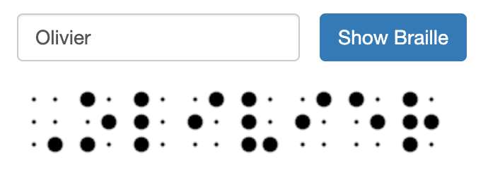
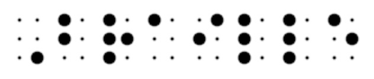
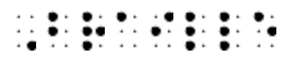
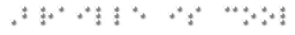
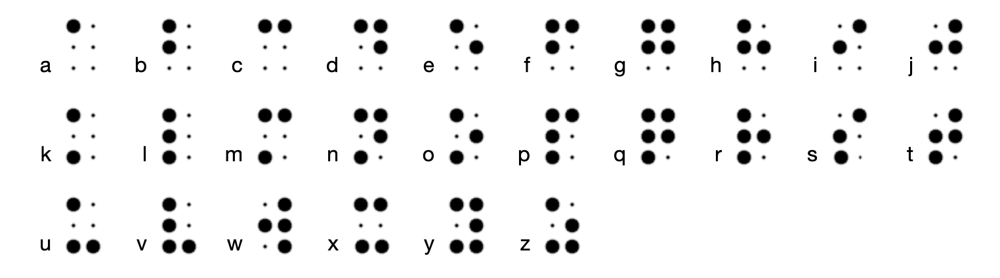

# Braille-Tools

A lightweight CSS and JavaScript library for displaying English Grade 1 Braille in web pages, designed to introduce sighted people to the Braille system.

**[▶ Live demo](https://evoluteur.github.io/braille-tools/)**

[](https://evoluteur.github.io/braille-tools/#braillename)

## Features

- **One CSS class per Braille character**: letters, numbers and common punctuation, drawn from a single image sprite.
- **Text to Braille in JavaScript**: `br.braille("Hello World")` returns the HTML for the whole text, adding the capital and number signs where needed.
- **The alphabet in one call**: `br.alphabet()` returns a to z with each letter next to its Braille cell.
- **3 visual styles**: big, small, and small-3d.
- **No dependencies**: one small JavaScript file and one CSS file.

## Visual styles

| Style    | CSS file               | Look                                         |
| -------- | ---------------------- | -------------------------------------------- |
| Big      | `braille-big.css`      |           |
| Small    | `braille-small.css`    |       |
| Small 3D | `braille-small-3d.css` |  |

## Setup

Copy the `css` folder and `braille-tools.js` into your project, then include the stylesheet of the style you want and the script:

```html
<link href="css/braille-big.css" rel="stylesheet" />
<script src="braille-tools.js"></script>
```

## Usage

### With CSS only

Each Braille character is an element with the class `br` and the class of that character:

```html
<div class="br br-a"></div>
<div class="br br-b"></div>
<div class="br br-c"></div>
```

Besides `br-a` to `br-z`, there are classes for the signs and punctuation, such as `br-cap` (capital sign), `br-num` (number sign), `br-sp` (space), `br-period`, `br-comma`, `br-qu` (question mark), and `br-ex` (exclamation mark). The [demo](https://evoluteur.github.io/braille-tools/) lists them all.

### With JavaScript

`br.braille(text)` returns the Braille HTML for a text:

```html
<div id="myBraille"></div>

<script>
  document.getElementById("myBraille").innerHTML = br.braille("Hello World");
</script>
```

It handles:

- letters (uppercase letters get the capital sign)
- numbers (with the number sign before each group of digits)
- spaces and line breaks
- common punctuation: `. , ? ! ' : ; ( ) * % [ ]`

Each character has a tooltip with its print equivalent.

`br.alphabet()` returns the whole alphabet, each letter next to its Braille cell:

```js
document.getElementById("alphabet").innerHTML = br.alphabet();
```



## Limits

This library is intended to help sighted people explore the Braille system. It does not assist screen readers, and it is not a tool for professional Braille transcription: it only does Grade 1 (uncontracted) English Braille, one character at a time.

## Related projects

- [Braille-Text](https://github.com/evoluteur/braille-text): displays the print characters when hovering over the Braille (with animation).
- [Braille Quiz](https://evoluteur.github.io/braille-quiz/) ([code](https://github.com/evoluteur/braille-quiz)): learn to read Braille.

## License

Braille-Tools is open source under the [MIT license](LICENSE.md).

Had fun with it? [Buy me a coffee by becoming a sponsor](https://github.com/sponsors/evoluteur).

(c) 2016-2026 [Olivier Giulieri](https://evoluteur.github.io/)
